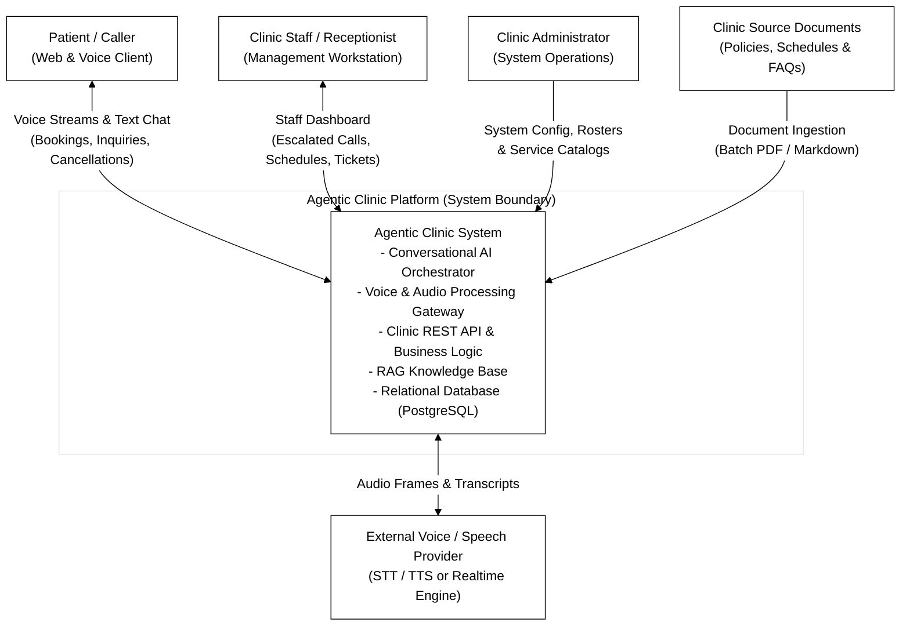

# 01 - System Context Diagram

## Diagram Preview

---

## Technical Specifications

- **Source File:** [`context-diagram.mmd`](context-diagram.mmd)
- **Purpose:** Establishes the outermost boundary of the Agentic Clinic platform and illustrates external actors, third-party services, and human users.
- **What it Shows:**
  - The central `Agentic Clinic System` boundary encompassing conversational AI, backend APIs, RAG, and database.
  - Three human actor classes: `Patient / Caller`, `Clinic Staff / Receptionist`, and `Clinic Administrator`.
  - External integration touchpoints: `External Voice / Speech Provider` and `Clinic Source Documents`.
- **What it Intentionally Does Not Show:**
  - Internal micro-routing, REST endpoint paths, database tables, or tool invocation chains (detailed in downstream architecture diagrams).
- **Related Documentation:**
  - [System Architecture Blueprint](../../architecture/system-architecture.md)
  - [Product Requirements](../../product/requirements.md)
