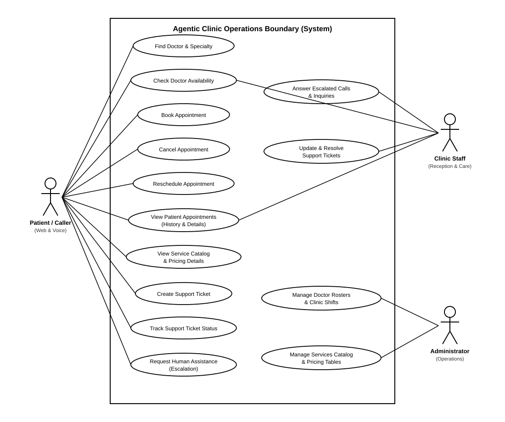
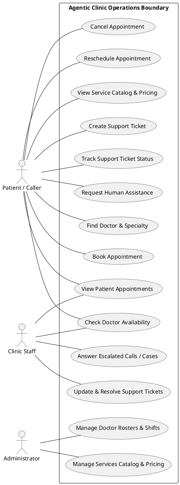
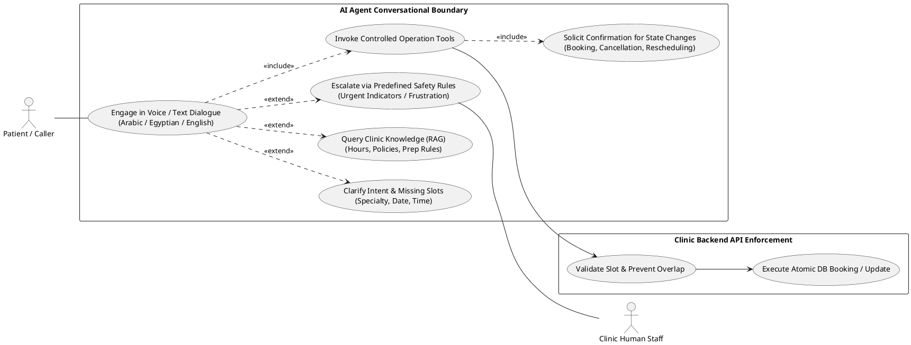

# 02 - UML Use Case Diagrams

This directory contains the official UML Use Case models for **Agentic Clinic**, adhering strictly to the **standard UML Use Case notation**:
- **Actors:** Represented as standard UML stick figures.
- **Use Cases:** Represented as standard UML horizontal ovals / ellipses.
- **System Boundaries:** Represented as clean enclosing rectangles.
- **Visual Style:** Pure black-and-white monochrome (high-contrast, professional, suitable for university thesis, academic reports, and printed documentation).

---

## 1. High-Level System Operations Use Case Diagram

### Visual Render (Standard UML: Stickman & Ovals)

### Source Specifications
- **Rendered SVG:** [`use-case-system.svg`](use-case-system.svg)
- **PlantUML Source:** [`use-case-system.puml`](use-case-system.puml)
- **Mermaid Source:** [`use-case-system.mmd`](use-case-system.mmd)

### Description & Boundaries:
- **Actors:**
  - `Patient / Caller`: Interacts via text chat and voice streams to discover doctors, inspect availability, manage appointments, query service fees, open support tickets, and request human assistance.
  - `Clinic Staff`: Receptionists and clinic coordinators who answer escalated calls, resolve customer tickets, view patient histories, and verify doctor schedules.
  - `Administrator`: Maintains doctor rosters, shifts, and the clinic service/pricing catalog.
- **Boundary:** Encloses core clinic functional operations within the `Agentic Clinic Operations Boundary`.

---

## 2. AI Agent Conversational Interaction Use Case Diagram

### Visual Render (Standard UML: Stickman & Ovals)

### Source Specifications
- **Rendered SVG:** [`use-case-ai-agent.svg`](use-case-ai-agent.svg)
- **PlantUML Source:** [`use-case-ai-agent.puml`](use-case-ai-agent.puml)
- **Mermaid Source:** [`use-case-ai-agent.mmd`](use-case-ai-agent.mmd)

### Description & Relationships:
- **Primary Actor:** `Patient / Caller` interacts with the primary use case `Engage in Voice / Text Dialogue`.
- **Secondary Actor:** `Clinic Human Staff` receives escalated sessions via the `Escalate via Predefined Safety Rules` use case.
- **UML Stereotypes:**
  - `«extend»`: Clarification of missing slots, RAG informational querying, and predefined safety escalation conditionally extend the dialogue.
  - `«include»`: Invoking controlled tools always includes mandatory user confirmation before executing state-altering actions (`book_appointment`, `cancel_appointment`, `reschedule_appointment`).
- **Backend Boundary:** Controlled tools invoke `Validate Slot & Rules` on the Clinic Backend REST API, which deterministically enforces constraints before `Execute Atomic Mutation` in PostgreSQL.

---

## 3. PlantUML Source Code

Click to view System Use Case PlantUML Source (use-case-system.puml)

Click to view AI Agent Interaction PlantUML Source (use-case-ai-agent.puml)

