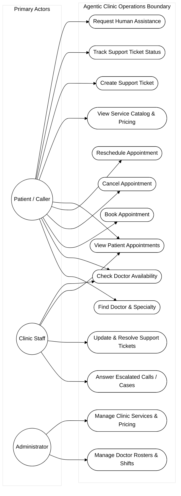
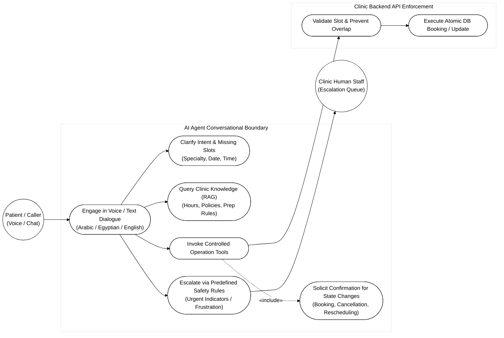

# 02 - Use Case Diagrams

This folder contains the complete UML Use Case documentation for **Agentic Clinic**, structured into a high-level system operations diagram and an AI agent interaction diagram.

---

## 1. High-Level System Use Case Diagram

- **Source File:** [`use-case-system.mmd`](use-case-system.mmd)
- **Purpose:** Maps functional capabilities across the three principal human actors.
- **What it Shows:**
  - Patient operations (finding doctors, availability, booking, rescheduling, cancellation, service checks, support ticketing).
  - Staff operations (handling human handoffs, resolving tickets, viewing patient appointments).
  - Admin operations (maintaining rosters, shifts, and medical catalogs).
- **What it Intentionally Does Not Show:** Internal software layers or database schemas.

---

## 2. AI Agent Interaction Use Case Diagram

- **Source File:** [`use-case-ai-agent.mmd`](use-case-ai-agent.mmd)
- **Purpose:** Illustrates how the AI Agent orchestrator mediates conversational intent, guardrails, confirmation checks, and backend execution.
- **What it Shows:**
  - Conversational understanding in Arabic, Egyptian dialect, and English.
  - Mandatory confirmation solicitation (`«include»`) prior to state-altering tool execution.
  - Escalation to human staff based on predefined safety rules and patient request.
  - Backend validation boundary ensuring zero unvalidated database writes.
- **Related Documentation:**
  - [Product Requirements](../../product/requirements.md)
  - [Tool Schemas Contract](../../architecture/tool-schemas.md)
