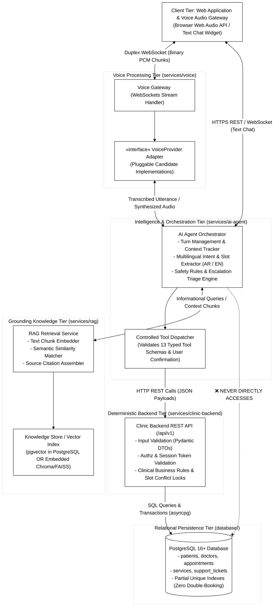
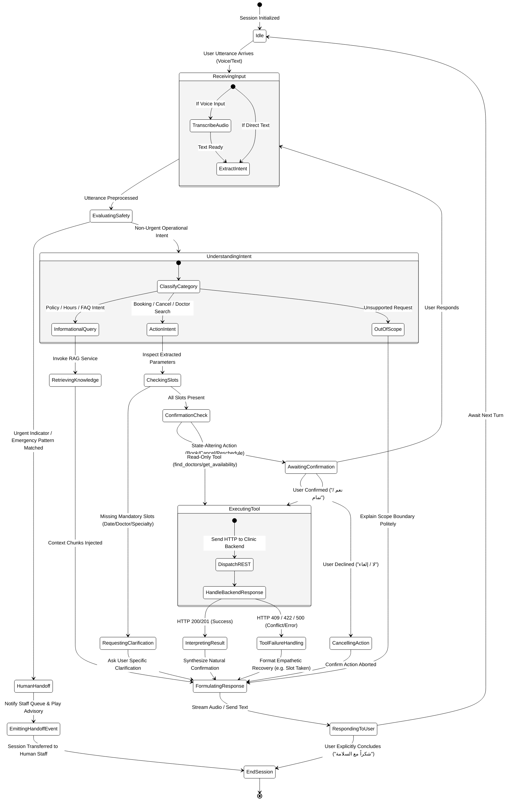
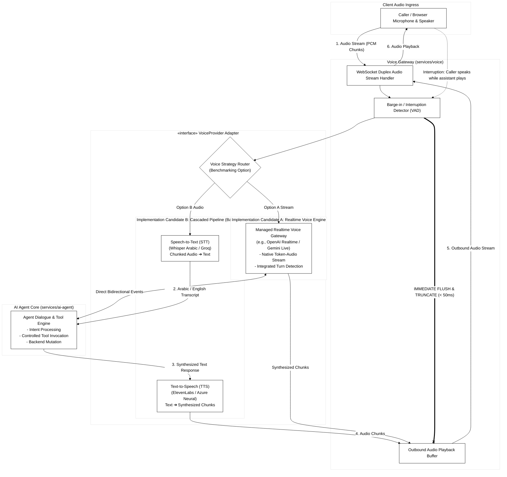

# 03 - Architecture & Workflow Diagrams

This directory contains architectural blueprints and runtime workflow diagrams illustrating subsystem relationships, agent state machines, and voice audio streaming.

---

## 1. Subsystem Architecture & Boundary Diagram

- **Source File:** [`architecture-subsystems.mmd`](architecture-subsystems.mmd)
- **Purpose:** Clarifies layer responsibilities and visually reinforces the zero-direct-database access rule.

---

## 2. AI Agent State & Workflow Diagram

- **Source File:** [`ai-agent-workflow.mmd`](ai-agent-workflow.mmd)
- **Purpose:** Models the complete internal control graph of the conversational orchestrator, showing slot checks, clarification loops, confirmation prompts, error recovery, and safety escalation.

---

## 3. Conceptual Voice Flow & Barge-in Diagram

- **Source File:** [`voice-flow-conceptual.mmd`](voice-flow-conceptual.mmd)
- **Purpose:** Details audio packet ingress, strategy routing between Candidate A (Realtime) and Candidate B (Cascaded), and immediate audio buffer truncation upon user barge-in.
- **Related Documentation:**
  - [Voice Architecture Contract](../../architecture/voice-architecture.md)
  - [Feasibility Audit (Section 2: Voice)](../../architecture/feasibility-audit.md)
