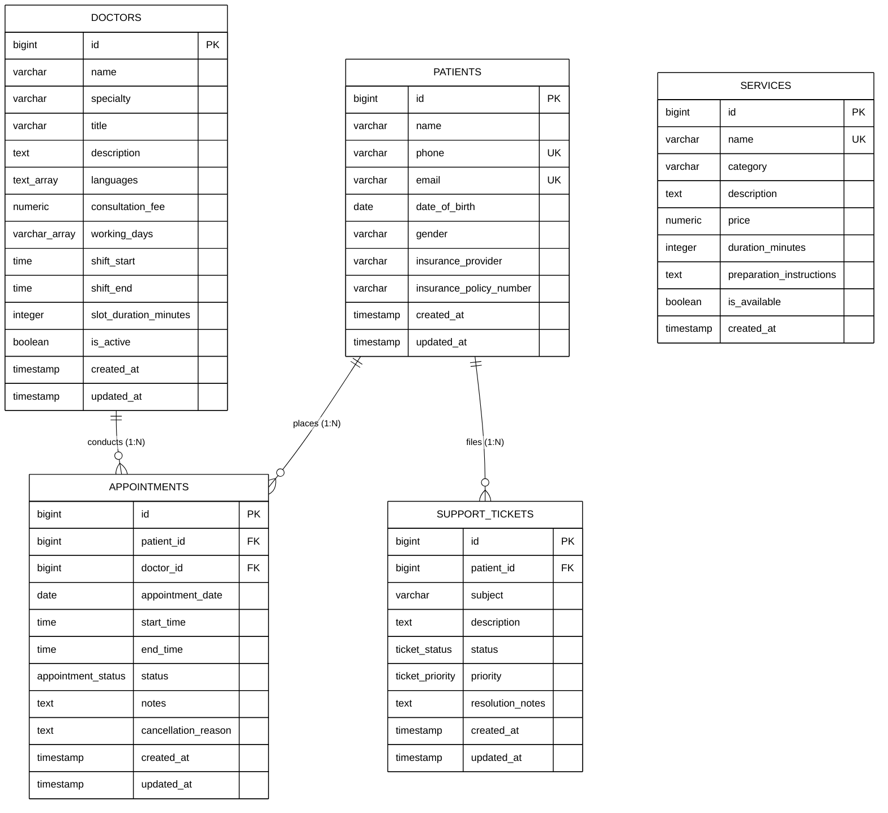
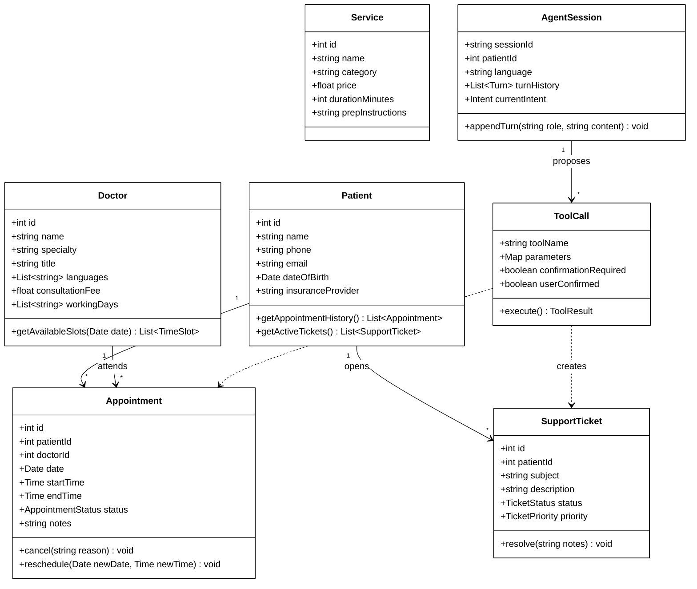
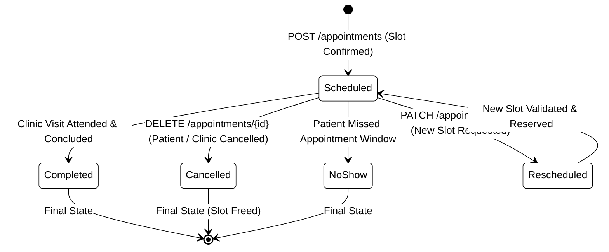
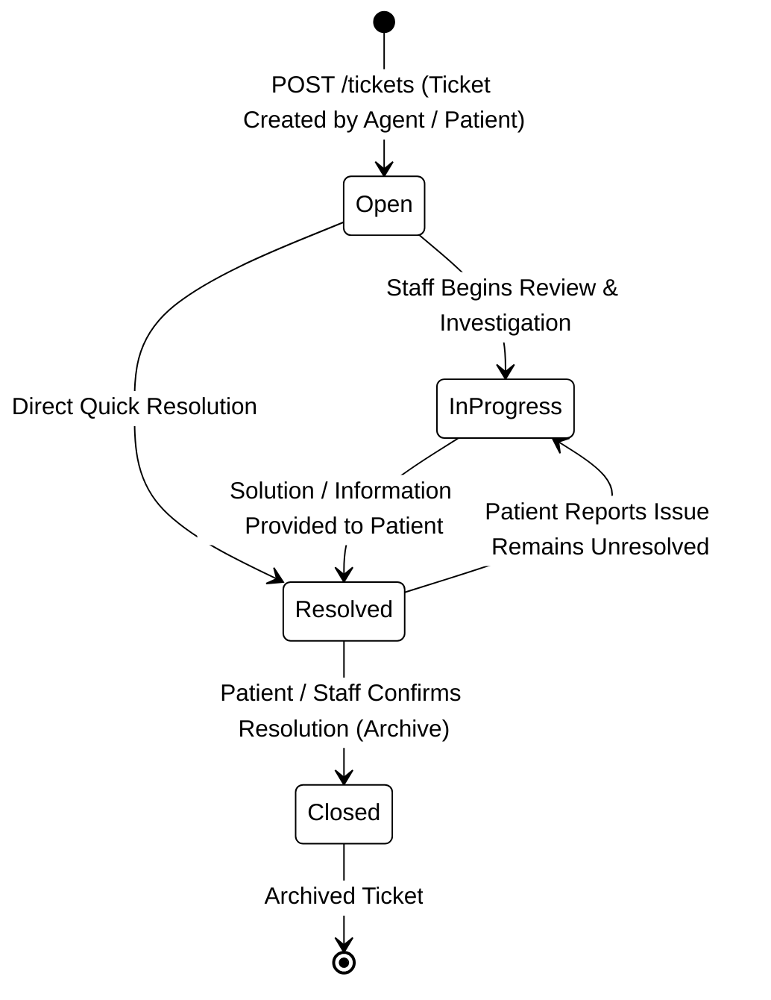

# 04 - Data Models, States & Data Flows

This directory contains the structural data models, entity relationships, entity state machines, and data flow diagrams.

---

## 1. Entity-Relationship Diagram (ERD)

- **Source File:** [`entity-relationship-diagram.mmd`](entity-relationship-diagram.mmd)
- **Purpose:** Full database entity structure, primary/foreign keys, and exact table attributes.

---

## 2. Conceptual Domain Class Diagram

- **Source File:** [`domain-class-diagram.mmd`](domain-class-diagram.mmd)
- **Purpose:** Object-oriented conceptual model linking clinical domain entities with conversational session state and tool executions.

---

## 3. Lifecycle State Diagrams

### Appointment State Diagram

- **Source File:** [`state-appointment.mmd`](state-appointment.mmd)

### Support Ticket State Diagram

- **Source File:** [`state-support-ticket.mmd`](state-support-ticket.mmd)

---

## 4. Data Flow Diagrams (DFDs)

### Level 1 DFD: Conversational Booking & Operations
- **Source File:** [`dfd-conversation-tools.mmd`](dfd-conversation-tools.mmd)
- Demonstrates audio stream processing, intent extraction, dialogue session caching, deterministic backend validation, and relational database writes.

### RAG Knowledge Ingestion & Retrieval DFD
- **Source File:** [`dfd-rag-ingestion.mmd`](dfd-rag-ingestion.mmd)
- Details the dual pipeline: offline document parsing/chunking/embedding into the vector store, and online query embedding/top-k retrieval with source citations.
