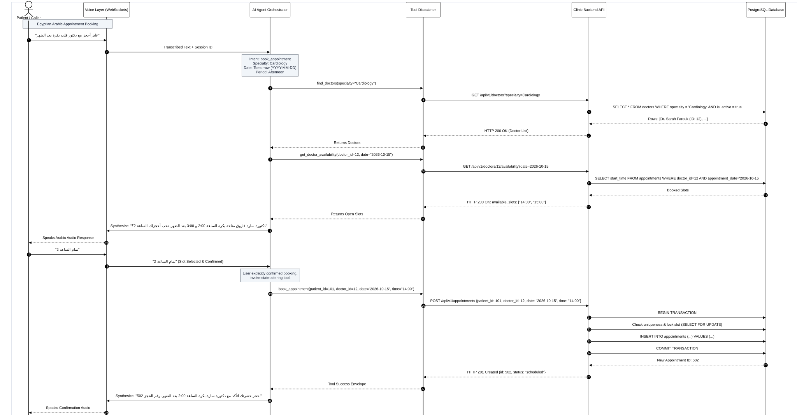
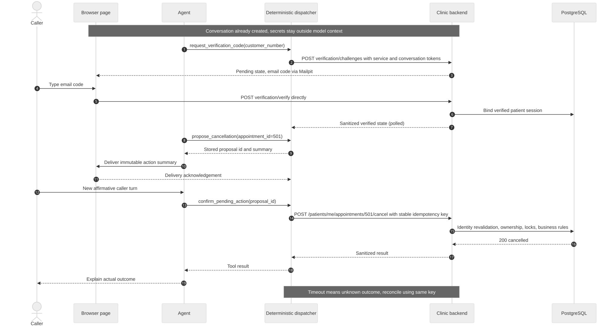
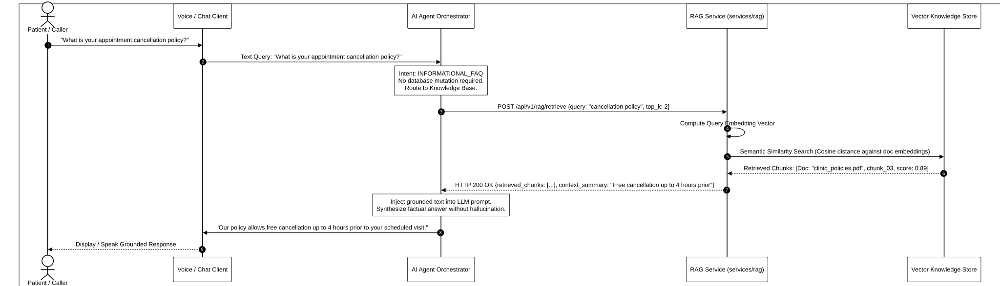
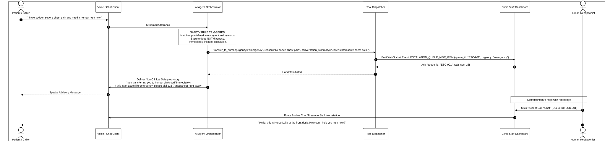
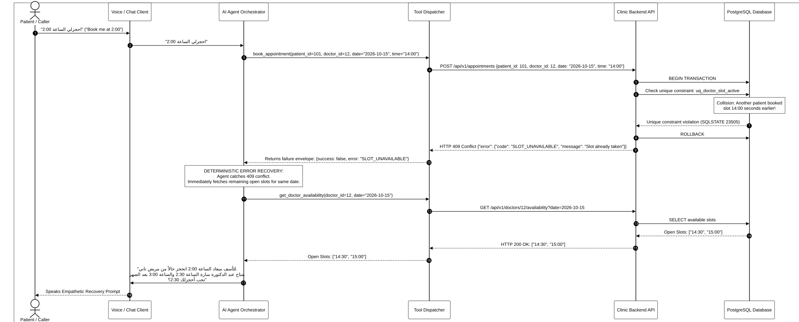
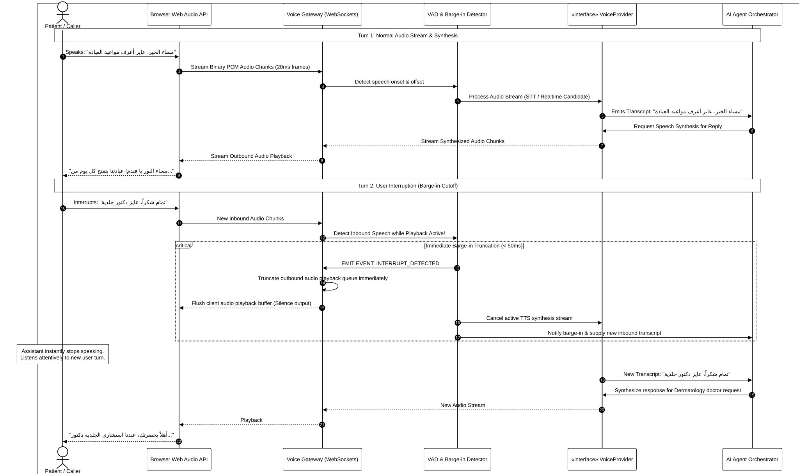

# 05 - Sequence Diagrams

This directory contains UML Sequence Diagrams detailing the exact temporal message flows, boundaries, and error recovery paths across the system.

All diagrams are rendered with an **opaque solid white canvas** for high-contrast viewing on both dark and light modes.

---

## 1. Appointment Booking Sequence (Egyptian Arabic)

- **Vector Image:** [`seq-appointment-booking.svg`](seq-appointment-booking.svg)
- **High-Res PNG:** [`seq-appointment-booking.png`](seq-appointment-booking.png)
- **Source File:** [`seq-appointment-booking.mmd`](seq-appointment-booking.mmd)
- **Key Flow:** Dialectal Arabic voice input ➔ Intent extraction ➔ `find_doctors` ➔ `get_doctor_availability` ➔ Conversational option summary ➔ Patient selection ➔ Mandatory confirmation ➔ Atomic database transaction via `POST /patients/me/appointments`.

---

## 2. Appointment Cancellation Sequence

- **Vector Image:** [`seq-appointment-cancellation.svg`](seq-appointment-cancellation.svg)
- **Source File:** [`seq-appointment-cancellation.mmd`](seq-appointment-cancellation.mmd)
- **Key Flow:** Cancellation request ➔ Appointment retrieval ➔ **Mandatory confirmation guardrail** ("Are you sure you want to cancel?") ➔ Explicit user confirmation ➔ Soft delete via `POST /patients/me/appointments/{id}/cancel` ➔ Slot freed in database.

---

## 3. RAG Knowledge Question Sequence

- **Vector Image:** [`seq-rag-query.svg`](seq-rag-query.svg)
- **Source File:** [`seq-rag-query.mmd`](seq-rag-query.mmd)
- **Key Flow:** User policy inquiry ➔ Routing to `services/rag` ➔ Vector search in knowledge store ➔ Top-k chunk return with citations ➔ Grounded prompt injection ➔ Factual non-hallucinated reply.

---

## 4. Predefined Safety Escalation & Human Handoff

- **Vector Image:** [`seq-human-handoff.svg`](seq-human-handoff.svg)
- **Source File:** [`seq-human-handoff.mmd`](seq-human-handoff.mmd)
- **Key Flow:** User reports acute symptoms / requests human ➔ Predefined safety rule trigger (non-diagnostic) ➔ `transfer_to_human` tool invocation ➔ Phase 1 truthful unavailable response; Phase 2 authenticated queue and separate connection state.

---

## 5. Failed Tool Call & Conflict Recovery

- **Vector Image:** [`seq-tool-call-failure.svg`](seq-tool-call-failure.svg)
- **Source File:** [`seq-tool-call-failure.mmd`](seq-tool-call-failure.mmd)
- **Key Flow:** Race-condition booking collision ➔ Unique partial index violation in PostgreSQL ➔ Backend rolls back transaction and emits `HTTP 409 Conflict` ➔ Agent catches conflict, queries remaining open slots, and gracefully offers alternatives to the caller.

---

## 6. Conceptual Voice Interaction & Barge-in Cutoff

- **Vector Image:** [`seq-voice-interaction.svg`](seq-voice-interaction.svg)
- **Source File:** [`seq-voice-interaction.mmd`](seq-voice-interaction.mmd)
- **Key Flow:** Duplex audio chunk streaming ➔ VAD speech detection ➔ Text synthesis ➔ Mid-speech user interruption (barge-in) ➔ Sub-50ms queue flush and stream cancellation ➔ Immediate listening to new turn.
