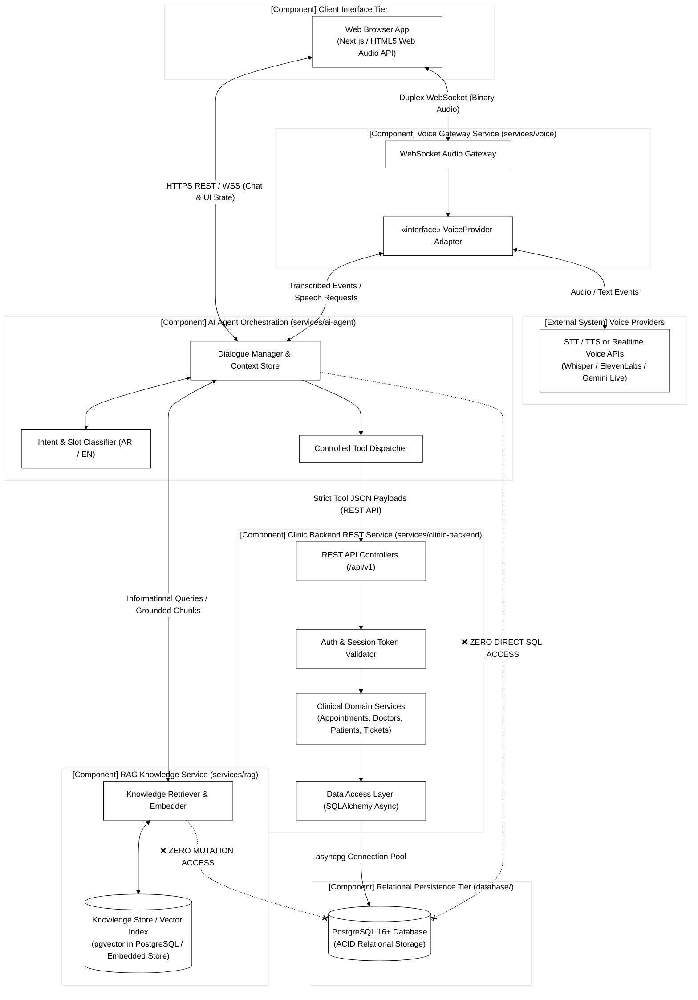

# 06 - Component Diagram

This directory contains the UML Component Diagram modeling service decoupling, structural dependencies, interfaces, and the controlled execution barrier.

---

## Diagram Preview

- **Source File:** [`component-diagram.mmd`](component-diagram.mmd)
- **Key Takeaway:** Formally anchors the structural dependencies:
  1. `AI Agent` depends strictly on `Tool Dispatcher`, which communicates with `Clinic Backend` via documented REST APIs.
  2. The LLM has zero direct link to `PostgreSQL`.
  3. `RAG Knowledge Service` is isolated from the transactional database and performs read-only semantic searches.
