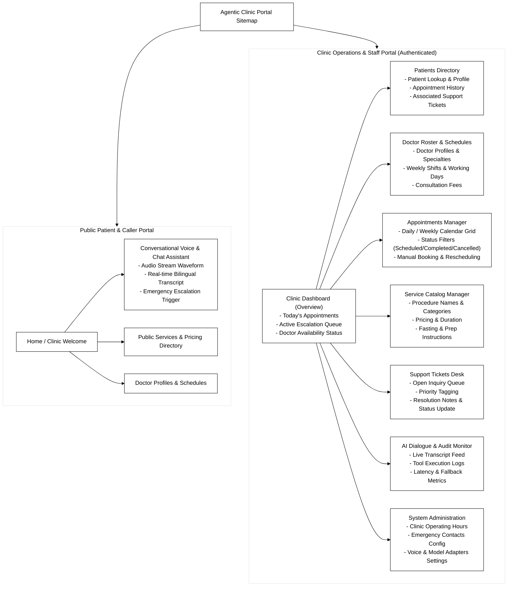

# 08 - UI Information Architecture

This directory contains the user interface sitemap and screen hierarchy for **Agentic Clinic**.

---

## Diagram Preview

- **Source File:** [`ui-information-architecture.mmd`](ui-information-architecture.mmd)
- **Purpose:** Maps the product structure into two distinct portals:
  1. **Public Patient Portal:** Clean, accessible patient interface containing the conversational voice/text assistant widget, service directory, and doctor schedules.
  2. **Staff Operations Portal:** Operational dashboard for clinic receptionists and administrators to manage appointments, doctor rosters, support tickets, and live escalated calls.
- **Related Documentation:**
  - [UI/UX Design System Guidelines](../../product/ui-ux-guidelines.md)
